  <picture>
    <source media="(prefers-color-scheme: dark)" srcset="https://readme-typing-svg.demolab.com?font=Inter&amp;weight=750&amp;size=68&amp;duration=2800&amp;pause=1300&amp;center=true&amp;vCenter=true&amp;width=350&amp;height=104&amp;letterSpacing=normal&amp;background=00000000&amp;lines=GM+Nevz&amp;color=E6EDF3" />
    <source media="(prefers-color-scheme: light)" srcset="https://readme-typing-svg.demolab.com?font=Inter&amp;weight=750&amp;size=68&amp;duration=2800&amp;pause=1300&amp;center=true&amp;vCenter=true&amp;width=350&amp;height=104&amp;letterSpacing=normal&amp;background=00000000&amp;lines=GM+Nevz&amp;color=24292F" />
    
  </picture>

<h3 align="center">Android ROM &amp; App Developer &bull; Kernel Enthusiast &bull; Open Source</h3>

Developing and customizing Android ROMs, kernels, and apps — from Samsung firmware to user-facing experiences.

---

## 🔱 Fork Projects

- **[ArtisanROM](https://github.com/edugrepo1-jpg/ArtisanROM)** — Custom firmware development for Samsung Galaxy devices.
- **[ParadoxUI](https://github.com/edugrepo1-jpg/ParadoxUI)** — Work-in-progress custom ROM for Samsung Galaxy devices.
- **[ArtisanKRNL / Exynos 990](https://github.com/edugrepo1-jpg/android_kernel_samsung_exynos990)** — Kernel development and experimentation.
- **[DuoStatusBar / DUO Recreate](https://github.com/edugrepo1-jpg/duoStatusBar)** — Android status-bar customization app with dynamic-island-style controls.

---

## 🛠️ Tech & interests

&nbsp;

&nbsp;

&nbsp;

&nbsp;

&nbsp;

&nbsp;

---

## 📊 GitHub activity

---

## 🐍 Contribution snake — eating contributions

<picture>
  <source media="(prefers-color-scheme: dark)" srcset="https://raw.githubusercontent.com/edugrepo1-jpg/edugrepo1-jpg/output/contribution-snake-arcade-v5-dark.svg" />
  <source media="(prefers-color-scheme: light)" srcset="https://raw.githubusercontent.com/edugrepo1-jpg/edugrepo1-jpg/output/contribution-snake-arcade-v5.svg" />
  
</picture>

The grid follows GitHub contribution colors; the arcade finale celebrates clearing the animated board. Updated by GitHub Actions.
